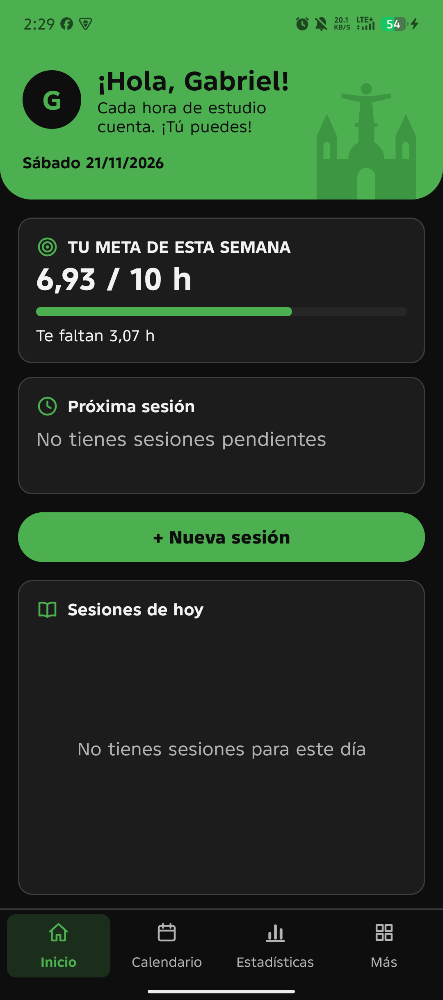
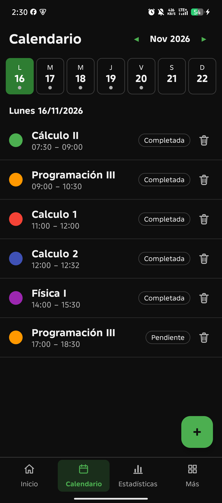
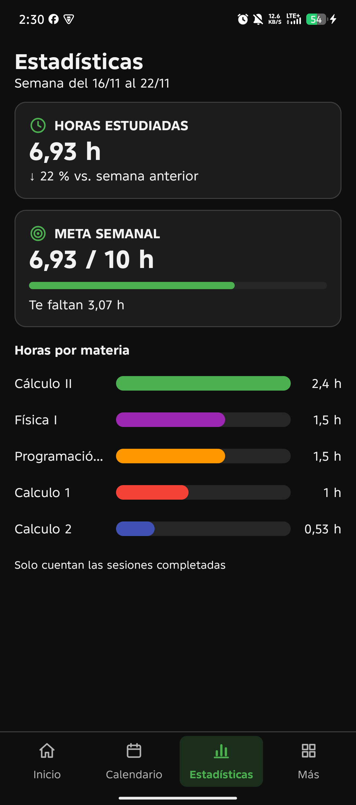
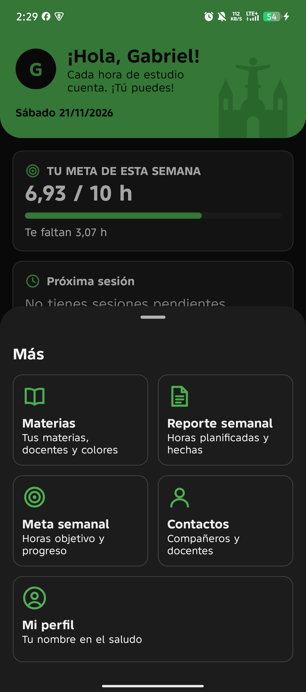
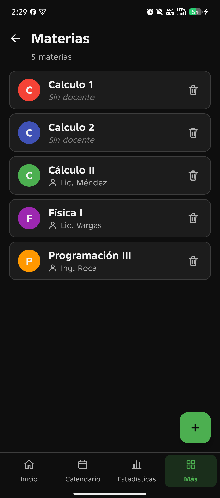
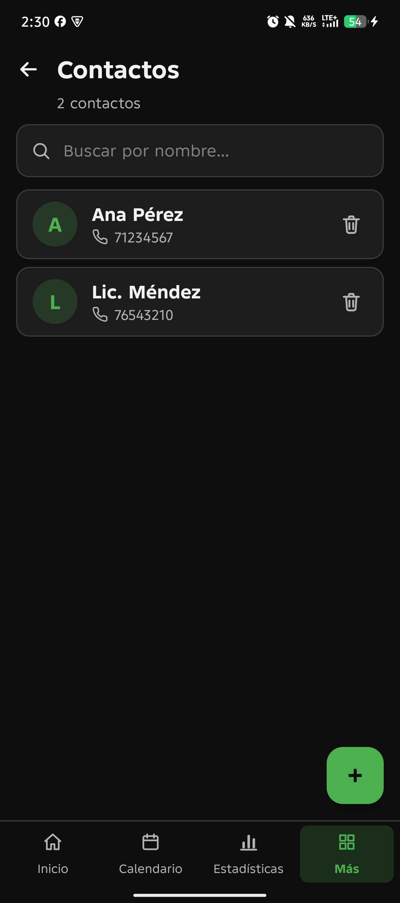
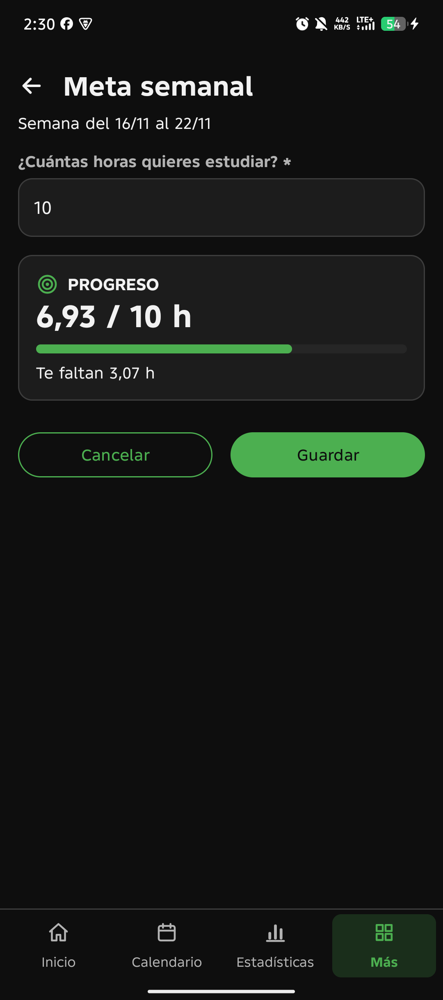

# Agenda de Estudio

App nativa Android en Java para gestionar y controlar las horas de estudio de un estudiante.

**Aplicaciones Móviles I** · Universidad Privada Domingo Savio (UPDS) · Docente: Ing. Daniel Román Terrazas · Gestión 2026

## Funciones

- **Materias:** registrar, ver, editar y eliminar materias con su docente y un color.
- **Sesiones de estudio:** planificar sesiones por día y hora en un calendario semanal y marcarlas como Pendiente, Completada o Reprogramada. Una sesión de hoy que está ocurriendo se ve "En curso" con una barra de avance, y "Terminar ahora" la cierra a la hora actual.
- **Meta semanal:** definir cuántas horas estudiar en la semana y ver el progreso en Inicio.
- **Reporte semanal:** horas planificadas, completadas y porcentaje por materia, con una fila de total.
- **Estadísticas:** horas de la semana, comparación con la semana anterior y una barra por materia.
- **Contactos:** compañeros y docentes con nombre, teléfono y correo, con buscador.
- **Mi perfil:** la app saluda al estudiante por su nombre.

Funciona sin internet y sin inicio de sesión: los datos se guardan solo en el teléfono. Para la meta, el reporte (horas hechas) y las estadísticas solo cuentan las sesiones **"Completada"**.

## Tecnologías y arquitectura

- Java y Android SDK (mínimo API 24, Android 7.0)
- SQLite con `SQLiteOpenHelper` (base `agenda.db`)
- `SharedPreferences` (nombre del perfil)
- AndroidX, AppCompat y Material Components

La app está organizada en 3 capas; cada capa solo habla con la de abajo (Vista → Controlador → Datos → SQLite):

| Capa | Paquetes | Qué hace |
|---|---|---|
| Vista | `com.gabriel.agenda.vista` | Pantallas (Activities), adaptadores de las listas y diálogos. Muestran datos y leen lo que escribe el usuario. |
| Controlador | `com.gabriel.agenda.controlador` | Validan los datos, calculan horas y porcentajes y devuelven mensajes o datos a la vista. |
| Datos (modelo y DAO) | `com.gabriel.agenda.modelo`<br>`com.gabriel.agenda.datos` | Clases simples (Materia, SesionEstudio, Contacto…) y los DAO, el único lugar con SQL. |

## Cómo ejecutarlo

1. Clonar el repositorio:
   ```bash
   git clone https://github.com/gabriel-torrico-1177/agenda-personal.git
   ```
2. Abrirlo en Android Studio y esperar a que sincronice Gradle.
3. Ejecutarlo (▶ Run) en un teléfono o emulador con Android 7.0 o superior.

También se puede compilar desde la terminal:

```bash
./gradlew assembleDebug      # Windows: gradlew.bat assembleDebug
```

El APK queda en `app/build/outputs/apk/debug/app-debug.apk`.

## Capturas

<table>
  <tr>
    <td align="center"><br><b>Inicio</b></td>
    <td align="center"><br><b>Calendario</b></td>
    <td align="center"><br><b>Estadísticas</b></td>
  </tr>
  <tr>
    <td align="center"><br><b>Panel Más</b></td>
    <td align="center"><br><b>Materias</b></td>
    <td align="center"><br><b>Contactos</b></td>
  </tr>
  <tr>
    <td align="center"><br><b>Meta semanal</b></td>
    <td></td>
    <td></td>
  </tr>
</table>

## Documentación

- [Historias de usuario y pruebas de aceptación](docs/historias-de-usuario.md): 16 historias, todas terminadas.
- [Bitácora de desarrollo](docs/bitacora.md): qué se hizo en cada paso y qué problemas hubo.
- [Diagramas](docs/diagramas/): secuencia, dominio, base de datos, clases, arquitectura, prototipo y wireframes.
- [Diagramas en Enterprise Architect](docs/ea/): modelo `.qea`, scripts y diagramas exportados.

---

Gabriel Torrico · Ingeniería de Sistemas · UPDS · 2026
